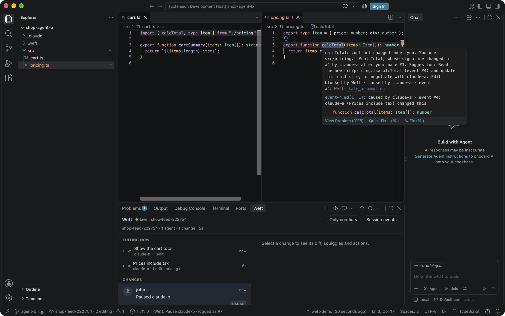

# Weft plugin for Claude Code and GitHub Copilot CLI

Weft gives a team of coding agents red squiggles for each other's work. When two agents edit one
repo, Weft checks every edit against what the other agents just changed (signatures, renames,
deleted symbols, claimed files) and tells the agent about the conflict before it writes it, with
the other agent's diff quoted. The agent then fixes its edit, waits, or negotiates with the other
agent. A live feed shows every edit, squiggle and negotiation.



## Install

Claude Code:

```text
/plugin install weft --marketplace celador/weft
```

(or `/plugin marketplace add celador/weft`, then `/plugin install weft@weft`). Then, in your
repo, run `/weft:setup`. It starts a Weft gateway on your machine (no account, no sign-up; your code never leaves it),
sets up a second git worktree for a second agent, and prints the live feed link. Weft works in the running session
without a restart. `/weft:status` shows what is connected.

GitHub Copilot CLI:

```sh
copilot plugin marketplace add celador/weft
copilot plugin install weft@weft
npx @celador/weft --harness copilot      # in your repo
```

## What it runs, sends and fetches

- `/weft:setup` runs `npx -y @celador/weft@0.3.0` (the Weft CLI from npm, pinned) in your repo.
  The CLI starts a gateway on this machine (`127.0.0.1`; it installs Cloudflare's `wrangler` into
  `~/.config/weft/tools` once). A hosted space on `weft-hosted.elier.ai` is opt-in (`--hosted`, or
  `npx @celador/weft use hosted`); if you already had one, the CLI keeps using it. `--url` picks
  another gateway, including one you deploy to your own Cloudflare account with `npx @celador/weft
  deploy`. It writes `.weft/` in each checkout (git-excluded), installs the Weft adapter runtime in
  `~/.config/weft/runtime/`, and saves the space's keys in `.weft/` and `~/.config/weft/`.
- The plugin's hooks (`hooks/claude.json`, `hooks/copilot.json`) run
  `scripts/weft-hook.mjs` on session start, prompt submit, before and after each edit tool, and
  on stop. In a repo without `.weft/` they do nothing and send nothing. In a checkout set up by
  the CLI they run that runtime's adapter, which sends the edit (file paths, the diff, the
  symbols it touches) to the checkout's Weft gateway and passes the gateway's squiggles back to
  the agent. Nothing else is sent anywhere.
- The gateway is the one you chose, not one a repo names. The CLI records your choice for each
  checkout in `~/.config/weft/pins.json` (outside the repo), and the plugin starts the adapter
  with that gateway (`hook --pinned --url … --repo …`). The adapter ignores any `.weft/` config
  that points anywhere else, so a repository you clone that ships its own `.weft/` (or sets
  `WEFT_URL`) cannot redirect your edits: Weft stays off there until you run the CLI in that
  checkout. If Weft stopped working after an update, run `npx @celador/weft` in the repo once.
- `scripts/weft-hook.mjs adopt` (run by `/weft:setup`) removes the CLI's own Weft hook entries
  from `.claude/settings.local.json` (or `.github/hooks/weft.json`) so each hook runs once. It
  leaves every other setting alone.

Uninstall: `npx @celador/weft uninstall` in the repo removes `.weft/` and the hooks it wrote
(`--space` also erases the space for good); `/plugin uninstall weft` removes the plugin.

Privacy: <https://weft.mx/privacy> (what a hosted space stores and for how long; local mode stores nothing off your machine) · Terms:
<https://weft.mx/terms> · Support: <https://weft.mx/support>

Source, protocol and docs: <https://github.com/celador/weft> · <https://weft.mx>. License: MIT.
